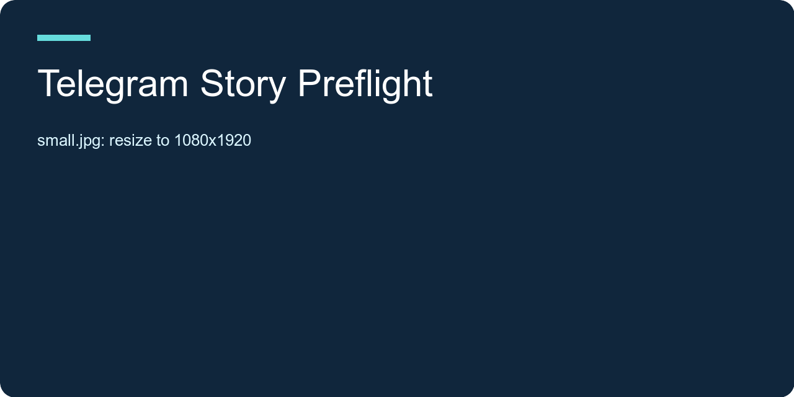

# Telegram Story Preflight

[Русский](README.ru.md)

Check local story media before uploading through the Telegram Bot API.



```sh
git clone https://github.com/TONstories/telegram-story-preflight.git
cd telegram-story-preflight
python3 preflight.py examples
```

```text
small.jpg: resize to 1080x1920
```

Install FFmpeg with ffprobe on PATH. Pass one file or a flat folder of assets. JPEG and PNG stills and MP4 videos are the intended inputs. Checks dimensions, file size, video codec and duration. Streamability, exact keyframe cadence, server acceptance and permissions require additional verification. [Bot API rules](https://core.telegram.org/bots/api#inputstorycontentvideo).

Python 3.9+. Add --json for structured results. Exit codes: 0 passes the implemented checks, 1 has findings, 2 indicates an input or invocation error.

0.152 s · macOS · Python · bundled example · single local run.

Built by TON Stories, a marketplace connecting advertisers with creators for Telegram Stories campaigns. [TON Stories](https://tonstories.com/?utm_source=github&utm_medium=referral&utm_campaign=open_source&utm_content=telegram-story-preflight) · [Telegram](https://t.me/TON_Storiesbot?start=gh_telegram_story_preflight)
